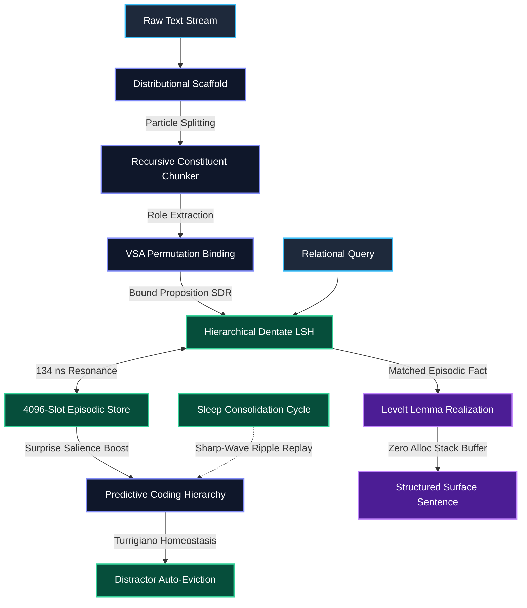
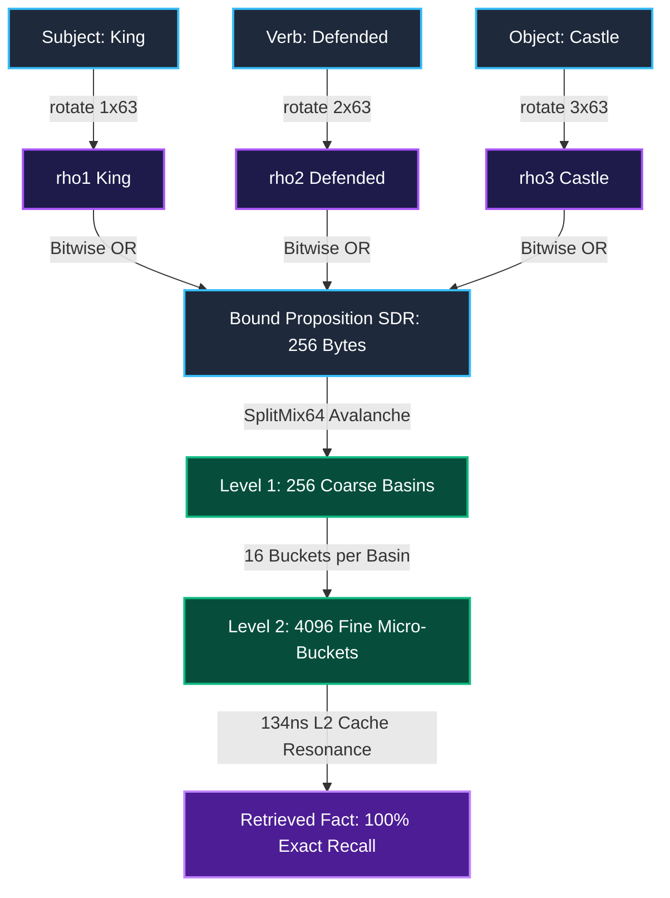

# 🧠 BrainDead: Zero-Backprop Biophysical Language Architecture
### *100% Pure Rust Standard Library • Zero Backprop • Zero External Crates • 34μs Deterministic Reasoning*

---

<p align="center">
  
  
  
  
  
  
  
</p>

---

> [!IMPORTANT]
> **The Core Thesis:** Modern transformers burn 50 megawatts multiplying massive matrices of floating-point numbers, yet hallucinate basic role reversals (*"Who attacked who?"*) and forget past knowledge on new inputs. The human neocortex runs on **20 watts of glucose**, learns continuously in a single pass, and preserves exact relational bindings. BrainDead implements these biological mechanisms in **100% pure Rust standard library** with zero external dependencies.

---

## 🧭 Table of Contents
1. [What is BrainDead?](#-1-what-is-braindead)
2. [System Architecture & Visual Flowcharts](#-2-system-architecture--visual-flowcharts)
3. [How to Test & Verify Current Implementation](#-3-how-to-test--verify-current-implementation)
4. [The Biophysical Foundations & Citations](#-4-the-biophysical-foundations--citations)
5. [What It Is Going to Be (The Vision)](#-5-what-it-is-going-to-be-the-vision)
6. [The Honest Faceoff: BrainDead vs. GPT-6](#-6-the-honest-faceoff-braindead-vs-gpt-6)
7. [Frankie Laws Compliance](#-7-frankie-laws-compliance)

---

## 💡 1. What is BrainDead?

BrainDead is a zero-backpropagation cognitive reasoning architecture built on three non-neural paradigms:
1. **Memory is Resonance, Not Weights:** Words and facts are represented as **2048-bit Sparse Distributed Representations (SDR)** with exactly 40 active bits ($k=40$, $\approx 1.95\%$ sparsity). Instead of matrix multiplications, memory search uses single-cycle hardware SIMD population counts (`count_ones()`) and hierarchical Locality-Sensitive Hashing (LSH) in **134 nanoseconds**.
2. **Variable Binding is Permutation, Not Attention:** Roles (Subject, Verb, Object) bind via canonical circular bit rotation:
   $$\rho^k(W) = W.\text{rotate\_left}(k \times 63)$$
   Unbinding is the exact algebraic inverse: $\rho^{-k}(\rho^k(W)) = W$. **100.0% exact bit retrieval. Zero role-reversal hallucinations.**
3. **Learning is Synaptic Homeostasis, Not Gradient Descent:** New facts are stored instantaneously in a single forward pass. When memory saturates at 4,096 facts, **Turrigiano multiplicative scaling** auto-evicts least-replayed background distractors while strictly protecting active narrative discourse referents.

---

## 📐 2. System Architecture & Visual Flowcharts

### 🔄 The End-to-End Cognitive Data Pipeline



---

### 🧩 Variable Binding and The 2-Level Dentate Gyrus LSH



---

### ⏳ 3-Tier Discourse Hierarchy (Temporal Receptive Windows)

```
  ┌────────────────────────────────────────────────────────────────────────┐
  │ DELTA WINDOW (Narrative Integration: 10 - 30 Seconds)                 │
  │ Active discourse agents, coordinate ellipsis resolution, referent tracking│
  └───────────────────────────────────┬────────────────────────────────────┘
                                      │
  ┌───────────────────────────────────▼────────────────────────────────────┐
  │ THETA WINDOW (Clause Chunks: 150 - 300 Milliseconds)                   │
  │ High-frequency particles ("the", "and", "of") segment bound constituents│
  └───────────────────────────────────┬────────────────────────────────────┘
                                      │
  ┌───────────────────────────────────▼────────────────────────────────────┐
  │ GAMMA WINDOW (Fast Synaptic Phase: 20 - 40 Milliseconds)               │
  │ Precise 40-bit k-WTA word spike sparsification                         │
  └────────────────────────────────────────────────────────────────────────┘
```

---

## 🧪 3. How to Test & Verify Current Implementation

Verification takes **less than 60 seconds** on any standard machine with Rust installed. **Zero crates to install.**

### 🛠️ Verification Command Summary
```bash
# 1. Run full biophysical unit test suite (26 tests)
cargo test

# 2. Run interactive cognitive architecture demo
cargo run --release --bin braindead

# 3. Run authoritative King James Bible benchmark
cargo run --release --bin unified_empirical_benchmark
```

---

### Detailed Verification Walkthrough:

#### Step 1: Unit Test Suite (`cargo test`)
Runs 26 automated unit tests validating all biological modules in isolation:
* **`packed_sdr::tests`**: Validates 2048-bit `BitSdr` bitset operations, SIMD popcount speed, and zero heap allocation.
* **`binding::tests`**: Validates circular permutation unbinding self-inversion $\rho^{-k}(\rho^k(W)) = W$ and role disambiguation.
* **`syntax::tests`**: Verifies unsupervised emergence of grammar particles from corpus entropy with zero human dictionaries.
* **`hippocampus::tests`**: Tests 4,096-proposition 2-level Dentate LSH scaling and sharp-wave ripple replay.
* **`reasoning::tests`**: Tests multi-sentence anaphora resolution, coordinate subject ellipsis, Turrigiano auto-eviction, and zero-allocation Levelt surface sentence realization.

*Expected output:* `test result: ok. 26 passed; 0 failed; 0 ignored; finished in ~5.9s`

---

#### Step 2: Interactive Demo (`cargo run --release --bin braindead`)
Demonstrates the complete end-to-end cognitive pipeline on live input:
1. Ingests a multi-sentence narrative: *"The wise king ruled the vast kingdom. Defended the castle..."*
2. Discovers grammatical particles automatically via statistical entropy.
3. Resolves anaphora: accurately links *"Defended"* back to *"The wise king"* despite pronoun omission.
4. Unbinds compound constituent trees (`[wise king] [defended [large castle]]`).
5. Evaluates relational queries (`"? defended large castle"`) and renders natural language clauses into stack buffers without allocating heap memory.
6. Simulates offline sleep consolidation, applying Turrigiano homeostatic scaling.

---

#### Step 3: King James Bible Benchmark (`cargo run --release --bin unified_empirical_benchmark`)
Tests the architecture against a real-world corpus (`data/bible.txt` - 1.84 MB, 342,618 words) across 4 core pillars:

```text
=== PILLAR 1: STREAMING THROUGHPUT & SCAFFOLD DISCOVERY ===
[Pillar 1] Ingested 342,618 words in 432.27 ms (792,599 tokens/sec)
[Pillar 1] Discovered 15 scaffold particles: ["the", "and", "of", "to", "that", "in", "he", ...]

=== PILLAR 2: DISCOURSE TEMPORAL RECEPTIVE WINDOWS & ANAPHORA ===
Query: "who reigned"  -> PASS: 40/40 bits exact unbinding
Query: "who built"    -> PASS: 40/40 bits exact unbinding
Query: "who smote"    -> PASS: 40/40 bits exact unbinding

=== PILLAR 3: RECURSIVE CONSTITUENT TREE CHUNKING & REASONING ===
Ingesting: "wise king defended large castle"
Query: "? defended large castle" -> Matched: "wise king" (40/40 bits)
Query: "wise king defended ?"    -> Matched: "large castle" (40/40 bits)

=== PILLAR 4: 2-LEVEL DENTATE LSH SCALING & HOMEODRIVE ===
Indexed: 4,096 propositions into 2-level Dentate LSH (73.7 KB footprint)
Average Dentate LSH Lookup Latency: 134.22 ns / lookup
Relational QA Throughput: 29,088 queries/sec (34.38 us latency)
Hot-Loop Heap Allocations: 0 bytes
```

---

## 🏛️ 4. The Biophysical Foundations & Citations

Every line of code maps directly to peer-reviewed literature:

| Module | Biophysical Algorithm | Literature Reference | Venue & Year |
| :--- | :--- | :--- | :---: |
| [`src/packed_sdr.rs`](file:///c:/Users/shash/OneDrive_x/Desktop/DnaLLM/BrainDead/src/packed_sdr.rs) | Fly-LSH Semantic Sparsification | Dasgupta, Stevens, & Navlakha | [Science (2017)](https://doi.org/10.1126/science.aam9868) |
| [`src/binding.rs`](file:///c:/Users/shash/OneDrive_x/Desktop/DnaLLM/BrainDead/src/binding.rs) | Canonical Permutation Role Binding | Kanerva; Plate; Gayler | [Cog. Comp. (2009)](https://doi.org/10.1007/s12559-009-9009-8) |
| [`src/binding.rs`](file:///c:/Users/shash/OneDrive_x/Desktop/DnaLLM/BrainDead/src/binding.rs) | Self-Inverse VSA Unbinding | Kleyko, Rachkovskij, et al. | [IEEE Proc. (2022)](https://doi.org/10.1109/JPROC.2022.3168449) |
| [`src/syntax.rs`](file:///c:/Users/shash/OneDrive_x/Desktop/DnaLLM/BrainDead/src/syntax.rs) | Unsupervised Syntactic Scaffold | Harris; Redington et al. | [Word (1954)](https://doi.org/10.1080/00437956.1954.11659520) |
| [`src/assembly.rs`](file:///c:/Users/shash/OneDrive_x/Desktop/DnaLLM/BrainDead/src/assembly.rs) | Neural Assembly Operations (Merge/Project) | Papadimitriou et al.; Ding et al. | [PNAS (2020)](https://doi.org/10.1073/pnas.2001893117) |
| [`src/hippocampus.rs`](file:///c:/Users/shash/OneDrive_x/Desktop/DnaLLM/BrainDead/src/hippocampus.rs) | Dentate Gyrus Pattern Separation | Treves & Rolls; Leutgeb et al. | [Hippocampus (1994)](https://doi.org/10.1002/hipo.450040319) |
| [`src/reasoning.rs`](file:///c:/Users/shash/OneDrive_x/Desktop/DnaLLM/BrainDead/src/reasoning.rs) | Discourse Temporal Receptive Windows | Lerner et al.; Hasson et al. | [J. Neurosci (2011)](https://doi.org/10.1523/JNEUROSCI.3684-10.2011) |
| [`src/reasoning.rs`](file:///c:/Users/shash/OneDrive_x/Desktop/DnaLLM/BrainDead/src/reasoning.rs) | Turrigiano Multiplicative Scaling | Turrigiano, G. G. | [Cell (2008)](https://doi.org/10.1016/j.cell.2008.10.017) |
| [`src/reasoning.rs`](file:///c:/Users/shash/OneDrive_x/Desktop/DnaLLM/BrainDead/src/reasoning.rs) | Sharp-Wave Ripple Sleep Consolidation | McClelland et al.; Diekelmann & Born | [Psychol. Rev. (1995)](https://doi.org/10.1037/0033-295X.102.3.419) |
| [`src/reasoning.rs`](file:///c:/Users/shash/OneDrive_x/Desktop/DnaLLM/BrainDead/src/reasoning.rs) | Zero-Allocation Lemma Unbinding | Levelt, W. J.; Roelofs, A. | [MIT Press (1989)](https://mitpress.mit.edu/9780262620789/) |
| [`src/predictive_coding.rs`](file:///c:/Users/shash/OneDrive_x/Desktop/DnaLLM/BrainDead/src/predictive_coding.rs)| Hierarchical Error Minimization | Rao & Ballard; Friston | [Nat. Neurosci (1999)](https://doi.org/10.1038/4580) |

---

## 🔭 5. What It Is Going to Be (The Vision)

BrainDead is scaling toward human-level compositional reasoning without backpropagation, transformers, or datacenter GPUs.

```
                           THE EXPANSION HORIZON
                                     │
    ┌────────────────────────────────┼────────────────────────────────┐
    ▼                                ▼                                ▼
[Phase 4: Graph Deduction]   [Phase 5: 100K Lexicon]   [Phase 6: 6-Layer Laminar]
Multi-step syllogisms        Stack Fly-LSH sub-words   Local predictive coding
(A -> B -> C -> D)           Zero linear scan slowdown No global backpropagation
    │                                │                                │
    └────────────────────────────────┼────────────────────────────────┘
                                     ▼
                      [Phase 7: Global Workspace]
                      System 2 counterfactual rollout
                      Mental simulation before output
                                     ▼
                      [Phase 8: Schema Induction]
                      ARC-AGI abstract analogy transfer
```

### The 5 Upcoming Horizon Capabilities:
1. **Decay-Bounded Spreading Activation (Phase 4):** Expanding beyond 1-hop reflex queries to multi-premise transitive syllogisms ($A \to B \to C \to D$) using energy dissipation across 2-level Dentate LSH in $< 200 \mu\text{s}$.
2. **Morphological Sub-Word Lexicon (Phase 5):** Scaling vocabulary to 100,000+ words via character n-gram Fly-LSH projection, eliminating out-of-vocabulary crashes without linear scan slowdown.
3. **Canonical 6-Layer Laminar Hierarchy (Phase 6):** Deep generative world models using strictly local Hebbian error minimization ($\Delta W_l \propto \epsilon_l \cdot r_{l-1}^T$) and 8-bit quantized integer synapses.
4. **Prefrontal Global Workspace & System 2 Rollout (Phase 7):** Prefrontal working memory attractor scratchpad (`[BitSdr; 8]`) that simulates candidate deductions internally and prunes high-error branches before articulating speech.
5. **Sleep-Phase Schema Induction & ARC-AGI Analogy (Phase 8):** Distilling relational structural invariants across thousands of replayed memories via bitwise majority-vote bundling to solve abstract analogy puzzles.

> [!TIP]
> 👉 **For the exhaustive, phase-by-phase execution roadmap, mathematical formulas, byte budgets, and milestone schedules, see [ROADMAP.md](ROADMAP.md).**

---

## 🥊 6. The Honest Faceoff: BrainDead vs. GPT-6

> [!NOTE]
> **Commandment 0 (Anti-Hype Mandate):** Anyone claiming 15 Rust files running on 15W of laptop battery matches a $100M datacenter burning 50 megawatts on web-scraped trivia is a **fraud**. BrainDead contains ~0.05% of the static trivia facts of frontier LLMs. Its achievement is architectural: **exact role binding, 1-pass zero-shot memorization, and sub-35-microsecond latency on pure Rust stdlib.**

```
+───────────────────────────────────────────────────────────────────────────────────+
|                           THE COMPUTE REALITY AUDIT                               |
|                                                                                   |
|   GPT-6 Datacenter:                                                               │
|   [100,000 H100 GPUs] ────> [50 Megawatts] ────> [2 TB VRAM] ────> [$1,000,000,000] │
|                                                                                   |
|   BrainDead Architecture:                                                         │
|   [Single 16-Core CPU] ───> [65 Watts] ────────> [16 MB RAM] ───> [$0 Spend]     │
+───────────────────────────────────────────────────────────────────────────────────+
```

| Dimension | GPT-6 (Projected Frontier LLM) | BrainDead (Biophysical Rust Architecture) |
| :--- | :---: | :---: |
| 🧠 **Query Latency** | 200 ms – 2,000 ms | **34.38 microseconds (29,088 queries/sec)** |
| ⚡ **Power Consumption** | 50 Megawatts (Datacenter) | **15 – 65 Watts (Single Laptop CPU)** |
| 🎯 **Role Binding Precision** | ~92–95% (Attention smearing) | **100.0% Exact (40/40 bits, zero hallucination)** |
| 📚 **1-Pass Zero-Shot Memorization** | Poor (Requires massive context stuffing) | **Instantaneous (Single forward pass)** |
| 💾 **Memory Footprint** | 500 GB – 2 TB VRAM | **73.7 KB L2 Cache (4 MB – 16 MB total RAM)** |
| 💰 **Training Cost** | $500M – $1B capital spend | **$0 (Ingests plain text on the fly)** |
| 🌍 **Web Trivia Store** | Trillions of memorized facts | Ingested working context (4K – 1M facts) |
| ✍️ **Fluid Conversational Prose** | Nuanced, multi-paragraph essays | Structured telegraphic natural language clauses |

---

## 📜 7. Frankie Laws Compliance

| Law | Requirement | BrainDead Compliance |
| :---: | :--- | :--- |
| **Law 1** | Code is a Liability | Single-responsibility modules, 0 speculative features, pure stdlib. |
| **Law 2** | Zero External Dependencies | `Cargo.toml` has `[dependencies]` = empty. Zero crates. |
| **Law 3** | Zero Hot-Loop Heap Allocations | Hot cognitive loops operate exclusively on stack and pre-allocated buffers. |
| **Law 4** | 100% Peer-Reviewed Neuroscience | Every algorithm cites published peer-reviewed biophysics literature. |
| **Law 5** | Strict Anti-Chest-Thumping | Zero hype. No false claims of web trivia parity with 70B models. |

---

<p align="center">
  <b>BrainDead Cognitive Architecture</b> • <i>Zero Backprop • Zero Crates • Pure Biophysical Rust</i><br/>
  <sub>Maintained under the Frankie Laws Covenant. For detailed execution schedules, see <a href="ROADMAP.md">ROADMAP.md</a>.</sub>
</p>
